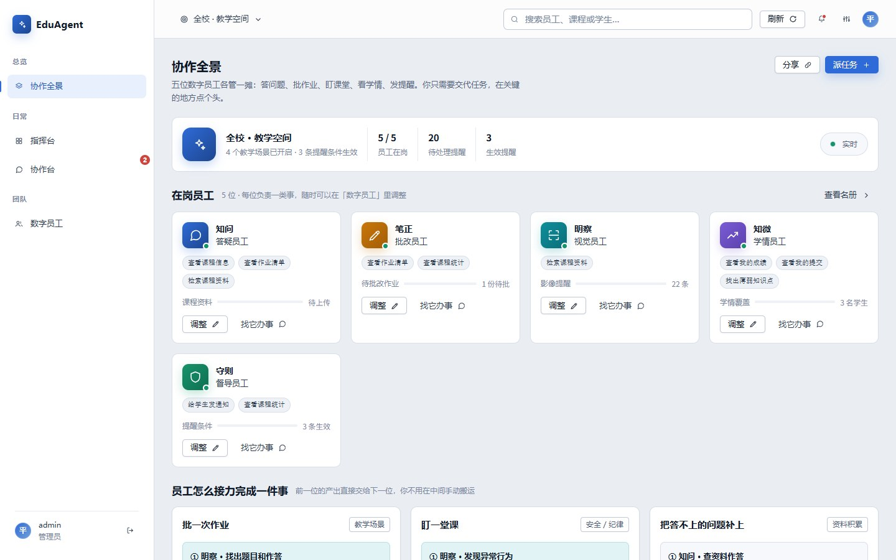
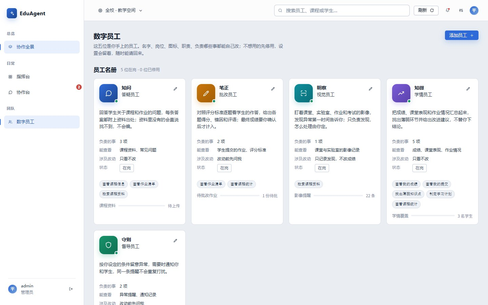
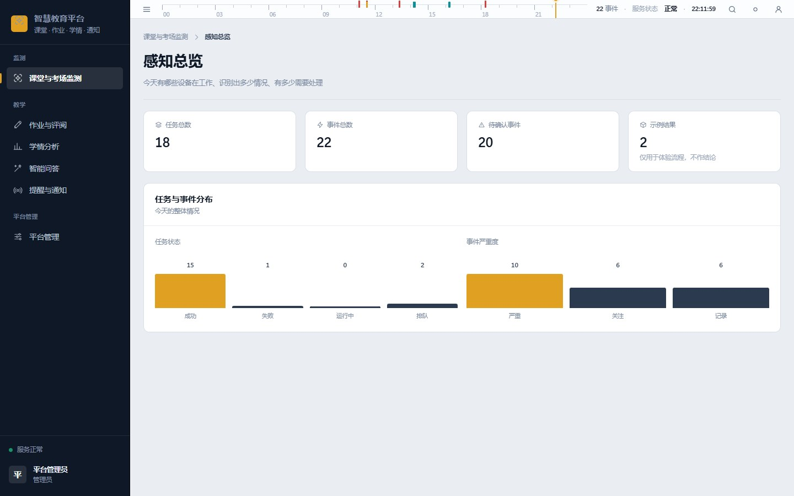
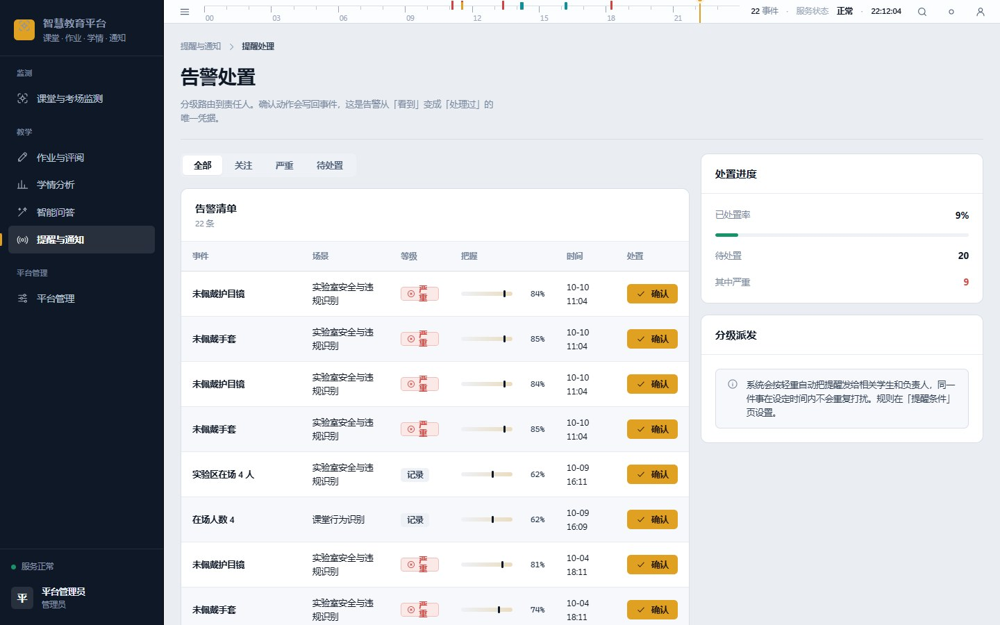
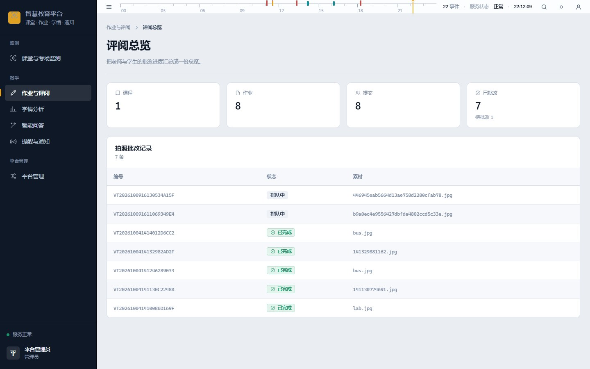
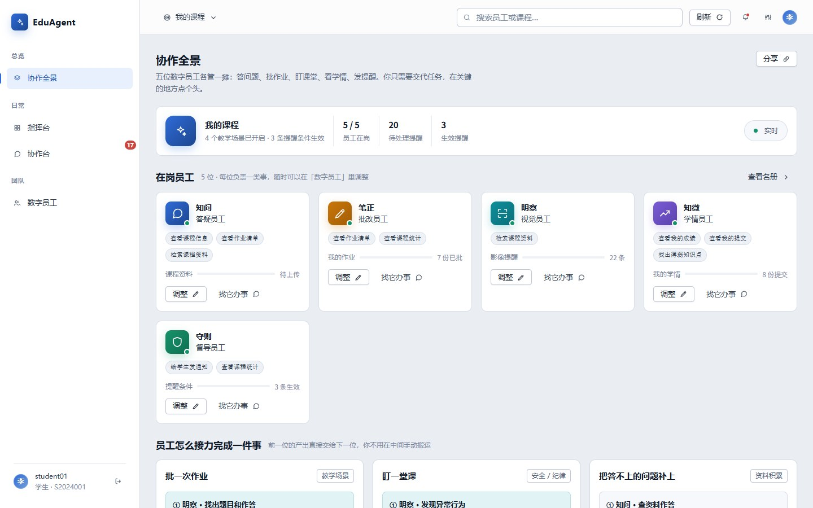
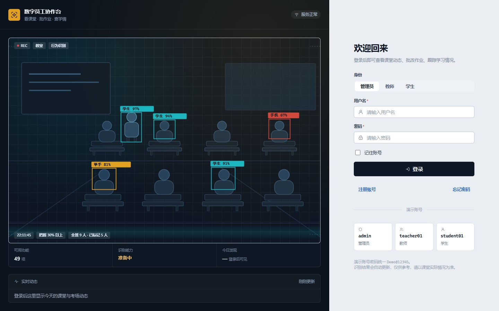
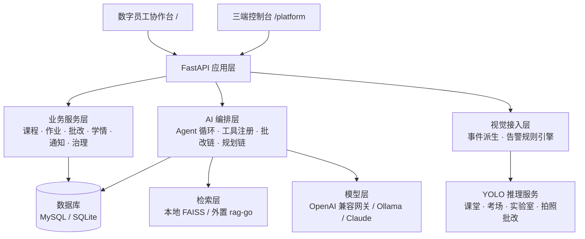

# EduAgent · 多员工 Agent 教育数字员工平台

> 把教育系统里的功能菜单，换成一屋子能派活的「数字员工」：
> 会答疑的、会批改的、盯课堂的、看学情的、管纪律的各司其职，
> 你只负责决定「这件事要不要照它说的办」。

EduAgent 是一个可演示、可复现的教学场景多员工 Agent 平台：FastAPI 做业务底座，LangChain 做
Agent 编排与工具调用，YOLO 做课堂与实验室的视觉感知，RAG 做课程资料检索。
所有「写动作」（记成绩、发通知、落事件）默认停在人工确认这一道闸门前。



---

## 目录

- [为什么叫数字员工](#为什么叫数字员工)
- [五位数字员工](#五位数字员工)
- [平台能力](#平台能力)
- [界面预览](#界面预览)
- [系统架构](#系统架构)
- [技术栈](#技术栈)
- [快速开始](#快速开始)
- [演示账号](#演示账号)
- [目录结构](#目录结构)
- [工程约定](#工程约定)
- [已知限制](#已知限制)
- [路线图](#路线图)
- [文档索引](#文档索引)
- [许可](#许可)

---

## 为什么叫数字员工

传统教务系统是「一堆页面，等人来点」。这里换了个组织方式：

1. **一个员工 = 岗位 + 可读的数据 + 可用工具 + 写权限级别**，而不是一个菜单项。
   不想要某个岗位，停用它即可，其余员工的协作关系不变。
2. **员工只出建议，写动作过闸门**。批改结果要教师确认才写成绩，提醒要按条件才发出去。
3. **看得见它怎么想的**。每次执行都留运行记录，可回看调用了哪些工具、读了哪些资料。

## 五位数字员工

| 员工 | 岗位 | 它读什么 | 它做什么 | 写权限 |
|------|------|----------|----------|--------|
| **知问** | 答疑员工 | 课程资料、常见问题 | 回答课程与作业问题，每条答案附资料出处；资料里没有就直说找不到 | 只读 |
| **笔正** | 批改员工 | 学生提交、评分标准 | 逐题给出得分、错因和评语 | 需教师确认 |
| **明察** | 视觉员工 | 课堂、实验室、作业与考试影像 | 识别异常并落成事件；只负责发现，不负责处理 | 写事件 |
| **知微** | 学情员工 | 成绩、课堂表现、作业情况 | 汇总薄弱环节、给改进建议，不替人下结论 | 只读 |
| **守则** | 督导员工 | 事件、通知记录 | 按设定条件提醒相关人，同一提醒不重复打扰 | 需人工确认 |

除五个内置岗位，还支持新建自定义岗位：填名称、职责描述、可读数据域、可用工具，选择写权限级别即可。

## 平台能力

平台有两个入口，同一套后端：

- **`/` 数字员工协作台** —— 以「员工」为单位的工作台，看员工在做什么、给它派活、看它交付了什么
- **`/platform` 三端控制台** —— 以「业务模块」为单位的完整后台，按角色显示不同菜单

| 模块 | 关键能力 | 主要角色 |
|------|----------|----------|
| 课堂与考场监测 | 感知总览、识别模型、训练图片集、识别任务、课堂行为/考场/实验室三种场景、拍照批改、记录回看与学生对应 | 教师、管理员 |
| 作业与评阅 | 作业发布、在线作答、人工批改、AI 批改、拍照上传批改、同伴互评、成绩查询、批改建议确认、教师评语库、批改质量复核 | 教师、学生 |
| 学情分析 | 学情总览、学生画像、学习诊断、学习路径规划、课堂参与度、学业与行为预警、学情报告 | 教师、学生、管理员 |
| 智能问答 | 课程资料入库、资料问答（带引用）、智能对话、规范对照、AI 处理记录 | 全部角色 |
| 提醒与通知 | 态势总览、实时提醒（WebSocket）、提醒条件、提醒处理、通知中心 | 全部角色 |
| 平台管理 | 治理总览、用户、组织、算力、文件、审计 | 管理员 |

## 界面预览

以下截图来自本地演示数据（`DB_BACKEND=sqlite` + `python scripts/seed_demo.py`），不是设计稿：
起一个临时实例后跑 `node scripts/shot_docs.mjs` 就能重新生成，界面改了图会跟着变。
脚本只读页面、不触发任何写操作。

<table>
  <tr>
    <td width="50%"><br>
      <sub><b>数字员工名单</b>：职责、能查看什么、改动前要不要问，都写在卡片上</sub></td>
    <td width="50%"><br>
      <sub><b>感知总览</b>：今天有多少设备在跑、抓到多少事、多少待确认</sub></td>
  </tr>
  <tr>
    <td><br>
      <sub><b>告警处置</b>：按严重程度分派给责任人，处置留痕</sub></td>
    <td><br>
      <sub><b>评阅总览</b>：拍照批改记录，素材只显示文件名不暴露路径</sub></td>
  </tr>
  <tr>
    <td><br>
      <sub><b>学生视图</b>：同一套员工，换成学生身份只看自己的课</sub></td>
    <td><br>
      <sub><b>登录页</b>：左侧是实时课堂识别画面，右侧按角色进入</sub></td>
  </tr>
</table>

## 系统架构



关键设计：视觉服务只回答「画面里有什么」，语义事件由业务侧规则派生。
因此换场景改的是规则，不是重训模型 —— 详见 [视觉感知链路](docs/02-架构设计/视觉感知链路.md)。

## 技术栈

| 层级 | 选型 | 说明 |
|------|------|------|
| Web 框架 | FastAPI 0.115 + Uvicorn | 异步接口 + WebSocket + 自动 OpenAPI |
| 数据层 | SQLAlchemy 2.0 Async | MySQL（生产）/ SQLite（演示）双后端 |
| 认证 | JWT | 三角色：管理员 / 教师 / 学生 |
| Agent 编排 | LangChain Runnable 链 + 自研循环 | 工具注册、决策契约、收敛出口 |
| 大模型 | OpenAI 兼容网关 / Ollama / Claude / 通义千问 | 可切换，缺省走规则降级 |
| 检索 | FAISS 本地检索，可外置 rag-go | 引用可溯源，无资料时拒答 |
| 视觉 | YOLO11 + 规则派生 | 端到端推理约 37 FPS（RTX 4060 Laptop） |
| 前端 | 原生 ES Module + 自研控制台框架 | 无构建步骤，改完刷新即生效 |

## 快速开始

**环境**：Python 3.11+（实测 3.12/3.13），Windows / macOS / Linux 均可。首次跑不需要数据库。

```bash
git clone <仓库地址> edu-ai-platform
cd edu-ai-platform

python -m venv .venv
# Windows: .venv\Scripts\Activate.ps1
# macOS / Linux: source .venv/bin/activate

pip install -r requirements.txt
cp .env.example .env          # 默认 DB_BACKEND=sqlite，开箱即用

python scripts/seed_demo.py   # 可选：写入演示课程、作业与学生数据
python run.py                 # http://127.0.0.1:18010
```

打开：

| 地址 | 内容 |
|------|------|
| `http://127.0.0.1:18010/` | 数字员工协作台（默认入口） |
| `http://127.0.0.1:18010/platform` | 三端控制台 |
| `http://127.0.0.1:18010/docs` | Swagger 接口文档 |

**想完全离线演示**：`.env` 里设 `AI_ENABLED=false`，所有 AI 入口走规则降级，界面照常可点。
**想用真实模型**：填 `OPENAI_API_KEY` + `OPENAI_BASE_URL`（带 `/v1`），或改用 Ollama。
**想用 MySQL**：`DB_BACKEND=mysql` 并补齐 `DB_*`，再执行 `alembic upgrade head`。

## 演示账号

| 账号 | 角色 | 说明 |
|------|------|------|
| `admin` | 管理员 | 全校口径：治理、审计、告警规则 |
| `teacher01` | 教师 | 张老师，带课程与作业 |
| `student01` | 学生 | 李同学，学号 `S2024001` |

密码统一为 `Demo@12345`，由 `scripts/seed_demo.py` 写入，仅供本地演示，部署到公网前必须更换。

## 目录结构

```
edu-ai-platform/
├── app/                 # FastAPI 应用
│   ├── main.py          # 入口与页面路由
│   ├── config.py        # 配置（全部来自环境变量）
│   ├── models/          # SQLAlchemy 模型
│   ├── schemas/         # Pydantic 出入参
│   ├── routers/         # 15 个路由模块（auth/teacher/student/vision/review/...）
│   ├── services/        # 业务逻辑
│   ├── middleware/      # 认证、响应驼峰化、缓存控制
│   └── core/            # 模型注册表、场景映射、事件派生
├── ai/                  # AI 层
│   ├── llm.py           # 唯一真实模型通道
│   ├── agents/          # Agent 循环、工具注册、记忆、教学参考实现
│   ├── rag/             # 检索（本地 / 外置）
│   ├── tools/           # 员工可调用的工具
│   └── workflows/       # 批改链、规划链
├── static/              # 前端（无构建步骤）
│   ├── desktop.html     # 数字员工协作台
│   ├── platform.html    # 三端控制台
│   ├── login.html
│   └── js/ css/
├── scripts/             # 种子数据、冒烟脚本、校验脚本
├── docs/                # 项目文档（见下）
├── alembic/             # 数据库迁移
└── run.py               # 启动入口
```

## 工程约定

二次开发前值得先知道的几条「反直觉」规则：

- **请求体用 `snake_case`，响应用 `camelCase`**：中间件只转换响应，不转换请求。
- **业务失败也可能返回 HTTP 200**：判断成功要看响应体里的 `code`（成功值是 `200`，不是 `0`）。
- **页面与 `/static/*` 一律 `no-cache` + ETag**：前端是多个独立 ES Module，必须避免只刷新到一半的新旧混搭。
- **检索必须显式指定课程范围**：否则会串到其他课程的资料。
- **写动作过闸门**：任何 AI 产出的成绩、通知、事件，落库前都要有人确认。
- **仓库里只有模板，真值只在本机 `.env`**：提交前跑 `python scripts/check_secrets.py`
  （查密钥形态、私网地址、本机绝对路径），详见 [密钥与配置管理](docs/03-开发指南/密钥与配置管理.md)。

## 已知限制

- 这是**可演示的 MVP**，不是生产级教务系统：缺权限审计、限流、灰度与监控告警。
- 未配置大模型时，问答与批改走检索式降级：能用，但正文未润色。
- 视觉场景中，拍照批改依赖专用类别权重（`question_block` / `handwriting`），需自训；
  其余场景复用 COCO 预训练权重即可。
- 自动化测试覆盖有限，主要靠 `scripts/` 下的冒烟与结构校验脚本兜底。

## 路线图

| 阶段 | 内容 | 状态 |
|------|------|------|
| M1 | 三角色业务闭环、认证与权限 | 已完成 |
| M2 | 数字员工协作台、控制台六模块 | 已完成 |
| M3 | 视觉感知链路、告警规则引擎、拍照批改 | 已完成 |
| M4 | Agent 循环重写：工具 → 模型 → 决策契约 → 循环 → 收敛 | 进行中 |
| M5 | 评测基线（检索引用率、批改误差、规划可执行性） | 待开始 |

## 文档索引

| 分类 | 文档 |
|------|------|
| 产品 | [项目概述](docs/01-产品定位/项目概述.md) · [数字员工能力矩阵](docs/01-产品定位/数字员工能力矩阵.md) · [数字员工协作平台设计说明](docs/01-产品定位/数字员工协作平台设计说明.md) · [功能模块重构规划](docs/01-产品定位/功能模块重构规划.md) |
| 架构 | [视觉感知链路](docs/02-架构设计/视觉感知链路.md) · [告警规则引擎](docs/02-架构设计/告警规则引擎.md) · [RAG 检索外置对接契约](docs/02-架构设计/RAG检索外置对接契约.md) |
| 开发 | [启动指南](docs/03-开发指南/启动指南.md) · [桌面端接口接入说明](docs/03-开发指南/桌面端接口接入说明.md) · [模型接入清单](docs/03-开发指南/模型接入清单.md) · [密钥与配置管理](docs/03-开发指南/密钥与配置管理.md) |
| 方案 | [教育大模型前期验证](docs/04-技术方案/教育大模型前期验证.md) · [YOLO 平台复刻方案](docs/04-技术方案/YOLO平台复刻方案.md) · [从零到一自学复现指南](docs/04-技术方案/自学复现指南.md) |
| 交付 | [项目计划书](docs/05-交付材料/项目计划书.md) · [工作成果梳理](docs/05-交付材料/工作成果梳理.md) |
| 归档 | [路由审计](docs/09-历史归档/路由审计报告_2026-10-12.md) · [旧页面下线](docs/09-历史归档/旧页面下线与路由收敛_2026-10-12.md) · [环境重建](docs/09-历史归档/环境重建与工作区清理_2026-10-10.md) · [身份连接键修复](docs/09-历史归档/身份连接键修复_2026-10-10.md) |

## 许可

[MIT](LICENSE) © 2026 yqy624
